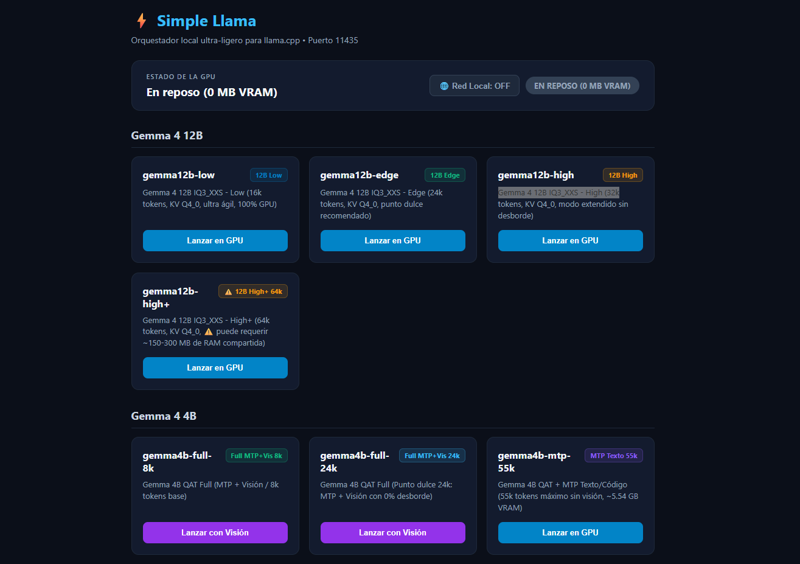

# ⚡ Simple Llama

> **Orquestador local ultra-ligero para [llama.cpp](https://github.com/ggerganov/llama.cpp)**. Diseñado con cero dependencias externas para ejecutar, conmutar y gestionar modelos de Inteligencia Artificial con aceleración **NVIDIA CUDA** y consumo ultra-eficiente de memoria.

[](https://www.python.org/)
[](https://github.com/ggerganov/llama.cpp)
[-success)](#-cero-dependencias-externas)
[](#)
[](#)

<div align="center">
  
</div>

---

## 🌟 ¿Qué es Simple Llama?

**Simple Llama** es un intermediario inteligente, servidor proxy multihilo y panel de control web que se sitúa frente al motor `llama-server.exe`. Permite gestionar modelos GGUF, realizar **hot-swap** instantáneo, ajustar el contexto y parámetros de muestreo en caliente, liberar la VRAM en periodos de inactividad y conectar clientes como **Zed Editor, OpenCode, Cursor, VS Code o Open WebUI** mediante una API compatible con el estándar de OpenAI.

### 💡 Características Principales:

1. **Cero Dependencias Externas:** 100% Python estándar (`http.server`, `urllib`, `threading`, `subprocess`, `json`). Sin `pip install`, sin entornos virtuales pesados.
2. **Servidor Concurrente Multihilo:** No se bloquea durante la inferencia o streaming. El panel de control responde instantáneamente en cualquier momento.
3. **Watchdog de Inactividad Inteligente:** Temporizador ajustable en caliente desde el panel (**10 min, 30 min, 60 min o continuo**) que apaga el modelo y libera el 100% de la VRAM (0 MB) cuando dejas de usarlo.
4. **Poda de RAM Física (`EmptyWorkingSet`):** Mantiene el consumo del orquestador en **< 40 MB de RAM**, a diferencia de servicios pesados como Ollama (2.5 – 3.2 GB).
5. **Configuración Centralizada Única:** Todos los perfiles se almacenan en un único archivo `models/config.json`. Sin escaneos invasivos fuera de su directorio.
6. **Panel Web Moderno con CRUD Total:**
   - **Crear perfiles:** Asistente interactivo con detección automática de archivos `.gguf`, adaptadores de visión (`mmproj`) y drafts especulativos (`MTP`).
   - **Editar perfiles en caliente:** Renombrado seguro de ID con sanitización automática, selector de presets de contexto (`4k` a `256k`), afinación de `min_p`, `reasoning_budget` (tokens de pensamiento), KV Cache K/V y Flash Attention.
   - **Eliminación segura:** Modal de confirmación con doble verificación que retira el perfil sin tocar tus archivos de modelo en disco.
   - **Hot-Reload:** Si editas los parámetros de un modelo que ya está corriendo en GPU, el orquestador lo reinicia automáticamente con la nueva configuración.
7. **Arquitectura de Seguridad Dual (Modo Hogar vs. Modo Público con PIN):**
   - **Modo Hogar:** Arranque seguro con LAN apagada por defecto. Encendido en un clic para acceso de dispositivos del hogar y **botón de corte remoto ("Kill Switch")** desde el celular. *Network Watcher* apaga la red automáticamente ante cambios de Wi-Fi o activación de VPNs.
   - **Modo Público:** Comparte la IA con amigos o compañeros permitiéndoles chatear o usar la API, con límites de tokens y sin permitirles conmutar modelos ni tocar la configuración del servidor, la cual queda protegida mediante PIN de administrador.
8. **Persistencia Atómica a Prueba de Fallos:** Catálogo protegido contra cortes de luz mediante escritura atómica (`atomic_write_json`) y respaldos automáticos `.bak` en sincronizaciones.
9. **Cancelación Quirúrgica de Inferencia:** Detén cualquier respuesta activa en 0.1s desde el panel web sin apagar el modelo ni vaciar la VRAM. Aislamiento estricto por cliente: un dispositivo puede frenar únicamente su propia consulta (`Detener mi petición`) sin interrumpir a otros usuarios en la red local. El administrador cuenta además con freno de emergencia global (`Detener todo`).
10. **Tarjeta de Estado Simétrica en 2 Filas:** Panel superior estructurado en dos niveles limpios (arriba: modelo en memoria y chat; abajo: conectividad LAN, temporizador y botones de parada), garantizando una interfaz sobria que nunca se descuadra en ningún dispositivo.

---

## 🚀 Inicio Rápido (Quickstart)

### 1. Requisitos Previos
- **Windows 10/11** o **Linux** con GPU NVIDIA y soporte CUDA.
- **Python 3.10 o superior** (compatible hasta Python 3.13+).
- Binario oficial de **[llama.cpp](https://github.com/ggerganov/llama.cpp/releases)** (`llama-server.exe` compilado con CUDA).

### 2. Estructura de Carpetas

```text
llamacpp/
├── llama-server.exe               # Binario oficial de llama.cpp (CUDA)
├── *.dll                          # Bibliotecas CUDA / OpenMP requeridas
└── orchestrator/                  # Repositorio Simple Llama
    ├── proxy.py                   # Servidor HTTP multihilo y proxy OpenAI
    ├── security.py                # Control de acceso LAN, modo dual, firewall y sesiones
    ├── manager.py                 # Gestor de procesos GPU, watchdog y hot-swap
    ├── config.py                  # Motor central de configuración, catálogo y guardado atómico
    ├── sync_opencode.py           # Sincronizador para OpenCode y agentes
    ├── templates/
    │   ├── dashboard.html         # Panel principal de administración web
    │   ├── public.html            # Portal de invitado y autenticación con PIN
    │   └── lan_disabled.html      # Pantalla segura de desconexión remota
    ├── models/                    # Directorio de modelos locales
    │   ├── config.json            # Configuración única de todos los perfiles
    │   ├── modelo.gguf            # Pesos del modelo principal
    │   ├── mmproj-F16.gguf        # Proyector de visión multimodal (opcional)
    │   └── mtp-draft.gguf         # Acelerador speculative / MTP (opcional)
    └── iniciar-servidor.bat       # Lanzador en un clic
```

### 3. Ejecución

Ejecuta el archivo **`iniciar-servidor.bat`** o arranca desde terminal:

```bash
python proxy.py
```

Al iniciar:
* **Panel Web de Control:** [`http://localhost:11435`](http://localhost:11435)
* **Endpoint API OpenAI:** `http://localhost:11435/v1`
* **Chat Web Nativo de llama.cpp:** `http://localhost:11436` (se levanta bajo demanda al cargar cualquier modelo)

---

## ⚙️ Configuración Centralizada (`models/config.json`)

El catálogo de modelos se gestiona en un archivo JSON estructurado por identificador de perfil:

```json
{
  "models": {
    "gemma12b-q3ks-edge": {
      "family": "Gemma 4 12B",
      "model_path": "gemma-4-12b-it-Q3_K_S.gguf",
      "ctx": 16384,
      "desc": "Gemma 4 12B Q3_K_S - Punto dulce 16k tokens, 100% GPU",
      "badge": "Q3_K_S 16k",
      "badge_color": "#10b981",
      "vision": false,
      "fa": "on",
      "cache_type_k": "q4_0",
      "cache_type_v": "q4_0",
      "temp": 1.0,
      "top_p": 0.95,
      "top_k": 64,
      "min_p": 0.05,
      "repeat_penalty": 1.08,
      "presence_penalty": 0.50
    },
    "ornith-edge": {
      "family": "Ornith 1.5 (9B)",
      "model_path": "Ornith-1.5-9B-GSQ-RCO-IQ3_M.gguf",
      "ctx": 73728,
      "desc": "Ornith 1.5 9B - 72k tokens con razonamiento nativo",
      "badge": "72k Recomendado",
      "badge_color": "#10b981",
      "vision": false,
      "fa": "on",
      "cache_type_k": "q8_0",
      "cache_type_v": "q8_0",
      "temp": 0.60,
      "top_p": 0.95,
      "top_k": 20,
      "repeat_penalty": 1.08,
      "reasoning_budget": 8192,
      "system_prompt": "Eres un asistente de inteligencia artificial útil y preciso..."
    }
  }
}
```

---

### 📋 Referencia de Parámetros de Perfil

| Parámetro | Tipo | Por Defecto | Descripción |
| :--- | :---: | :---: | :--- |
| **`family`** | `string` | `"General"` | Familia o agrupación visual en el dashboard. |
| **`model_path`** | `string` | *Obligatorio* | Nombre del archivo `.gguf` en `models/`. |
| **`ctx`** | `integer` | `8192` | Límite máximo de contexto en tokens (admite presets de 4k a 256k). |
| **`desc`** | `string` | Auto | Descripción mostrada en la tarjeta del modelo. |
| **`badge`** | `string` | Auto | Texto de la etiqueta distintiva. |
| **`badge_color`** | `string` | `"#38bdf8"` | Color hexadecimal del badge (admite selector visual y swatches). |
| **`vision`** | `boolean` | `false` | Indica si el perfil soporta imágenes multimodales. |
| **`projector_path`** | `string` | `null` | Nombre del archivo `mmproj-*.gguf` para visión. |
| **`draft_path`** | `string` | `null` | Archivo de modelo borrador para speculative decoding (o `__embedded__`). |
| **`spec_type`** | `string` | `null` | Tipo de especulación (ej. `"draft-mtp"`). |
| **`cache_type_k`** | `string` | `"q8_0"` | Cuantización de llaves de atención (`q8_0` recomendado, `q4_0`, `f16`). |
| **`cache_type_v`** | `string` | `"q8_0"` | Cuantización de valores de atención (`q8_0` recomendado, `q4_0`, `f16`). |
| **`fa`** | `string` | `"on"` | Flash Attention (`"on"` / `"off"`). Reduce uso de VRAM a $O(N)$. |
| **`temp`** | `float` | `0.70` | Temperatura de muestreo estocástico. |
| **`top_p`** | `float` | `0.95` | Muestreo por probabilidad acumulada (Nucleus). |
| **`top_k`** | `integer` | `40` | Límite de tokens candidatos considerados. |
| **`min_p`** | `float` | `null` | Muestreo Min-P (probabilidad mínima relativa al mejor token). |
| **`repeat_penalty`** | `float` | `null` | Penalización por repetición (ej. `1.08` para evitar bucles). |
| **`presence_penalty`** | `float` | `null` | Penalización de presencia por aparición de nuevos temas. |
| **`reasoning_budget`** | `integer` | `null` | Presupuesto máximo de tokens de pensamiento (`<think>`). |
| **`system_prompt`** | `string` | `null` | Directiva maestra inyectada automáticamente en las conversaciones. |

---

## 🌐 Seguridad y Control de Red Local (Dual Mode)

Simple Llama incorpora una arquitectura de seguridad por capas con **cero configuración de firewall manual** y protección contra filtraciones:

### 1. Modo Hogar (Arranque por Defecto)
* **Aislado al iniciar:** El servidor arranca con la red local en **OFF**. Solo la propia PC (`localhost` / `127.0.0.1`) tiene acceso.
* **Activación en un clic:** Al pulsar `Red Local: OFF` en el panel, se autoriza el tráfico en tu Wi-Fi/LAN para teléfonos, tablets u otras PCs de tu hogar, sin requerir contraseñas engorrosas en tu red privada.
* **Botón de Corte Remoto ("Kill Switch"):** Puedes pulsar "Desactivar y Aislar" directamente desde la pantalla de tu celular o tablet. El servidor corta la conexión remota al instante sin descargar el modelo de la GPU.
* **Network Watcher:** Si tu laptop cambia de red (ej. te conectas al Wi-Fi de una cafetería o activas una VPN), el servidor apaga automáticamente la LAN para proteger tu equipo.
* **Privacidad efímera:** El estado de la red nunca se escribe en disco; cada reinicio vuelve a un estado completamente seguro y cerrado.

### 2. Modo Público con PIN (Para compartir con amigos o compañeros)
Si deseas compartir tu potencia de IA con otras personas en tu red local (oficina, universidad, cowork) sin permitirles alterar tus modelos:

```powershell
.\iniciar-servidor.bat --lan --admin-pin MI_PIN_SECRETO
```

* **Portal de Invitado (`templates/public.html`):** Los dispositivos externos ven una página minimalista y oscura con la URL de la API (`/v1`), el modelo en uso y un botón directo **"Abrir Chat Web ↗"** para chatear en el navegador sin apps adicionales.
* **Blindaje de GPU contra Conmutación:** Los invitados **no pueden cambiar de modelo ni vaciar la VRAM**. Si un cliente externo envía un prompt pidiendo otro modelo, el orquestador lo redirige silenciosamente al modelo fijado por el administrador.
* **Tope de Recursos:** Las peticiones de invitados están limitadas automáticamente a 2048 tokens por respuesta y un máximo de 2 consultas simultáneas (personalizable con `--max-tokens` y `--max-concurrent`).
* **Desbloqueo Remoto con PIN:** Solo el administrador puede ingresar su PIN en el portal web para desbloquear el panel de control completo desde su teléfono o tablet.

### 3. Arquitectura de Puertos Desacoplada
* **Puerto `11435` (Orquestador & API):** Sirve el panel de control, la API OpenAI (`/v1`), el portal público y la gestión de modelos.
* **Puerto `11436` (Pasarela Llama UI):** Pasarela de acceso seguro que conecta con la interfaz nativa de `llama-server`.
* **Puerto `11437` (Backend Llama.cpp):** Escucha exclusivamente en `127.0.0.1` (loopback interno), inaccesible desde el exterior para máxima seguridad.

### 4. Persistencia Atómica a Prueba de Cortes
* Todas las modificaciones a `models/config.json` se escriben de forma **atómica** (`atomic_write_json` mediante archivos temporales y reemplazo atómico del SO). Si tu PC sufre un corte de energía mientras editas un perfil, tu catálogo nunca quedará corrupto.
* Las sincronizaciones con herramientas de agentes generan respaldos `.bak` automáticos.

---

## 📊 Comparativa: Simple Llama vs. Ollama

| Característica | Ollama Estándar | Simple Llama |
| :--- | :---: | :---: |
| **Consumo de RAM Física** | 2.5 – 3.2 GB | **< 40 MB** (Poda `EmptyWorkingSet`) |
| **Reposo de GPU (Inactividad)** | Mantiene VRAM ocupada | **Watchdog:** 0 MB VRAM tras timeout configurable |
| **Cambio de Modelo (Hot-swap)** | Puede dejar procesos huérfanos | **Atómico y limpio:** Cierra previo antes del nuevo |
| **Flash Attention (FA)** | Variable según versión | **Control explícito (`-fa on`)** |
| **Control de KV Cache** | Fijo no configurable | **Personalizable por perfil (`q8_0`, `q4_0`, `f16`)** |
| **Concurrencia en Streaming** | Panel bloqueado a menudo | **Multihilo:** Panel y control accesibles durante inferencia |
| **Cancelación de Inferencia** | Si el cliente no cierra el socket, la GPU sigue generando | **Quirúrgica por web:** Detención selectiva por IP o global en 0.1s |
| **Dependencias del Sistema** | Servicio en segundo plano / Go | **Cero dependencias externas:** Python estándar puro |

---

## 🔌 Conexión con Clientes y Editores

Simple Llama expone una API compatible con el estándar de OpenAI en el puerto **11435**.

### 1. Zed Editor
Configura tu proveedor en `settings.json` de Zed:

```json
{
  "language_models": {
    "openai": {
      "api_url": "http://localhost:11435/v1",
      "available_models": ["gemma12b-q3ks-edge", "ornith-edge", "qwen-9b-iq3-coding"]
    }
  }
}
```

### 2. OpenCode / Pi Agent
Ejecuta el script incluido **`sync_opencode.py`**: escaneará los modelos activos y los sincronizará automáticamente con tus archivos de configuración locales.

### 3. Cursor / VS Code / Open WebUI
* **Base URL:** `http://localhost:11435/v1`
* **API Key:** `sk-local` (o cualquier valor de texto).
* **Model ID:** El nombre exacto del perfil (ej. `gemma12b-q3ks-edge`, `ornith-edge`).

### 4. Obsidian (Copilot) & Chatbox
Compatible de forma nativa como proveedor OpenAI personalizado:
* **Base URL / Endpoint:** `http://localhost:11435/v1` (o con la IP de tu PC en la red local: `http://192.168.x.x:11435/v1`).
* **API Key:** `sk-local` (o cualquier texto).
* **Streaming:** Totalmente funcional con recepción token a token y cancelación inmediata disponible desde el panel web.

---

## 📄 Licencia

Distribuido bajo la Licencia **MIT**. Consulta el archivo `LICENSE` para más información.

---

## ⚖️ Avisos Legales y Descargo de Responsabilidad (Disclaimer)

* **Marcas Registradas:** *Simple Llama* es un proyecto independiente de código abierto y no está afiliado, respaldado ni patrocinado por Meta Platforms, Inc., Google LLC, ni por el proyecto oficial `llama.cpp` de Georgi Gerganov. Todos los nombres de marcas, modelos o productos referenciados pertenecen a sus respectivos titulares.
* **Licenciamiento de Modelos:** Este software no distribuye ni almacena pesos de modelos (`.gguf`). Es responsabilidad exclusiva del usuario verificar y cumplir las condiciones de uso, licencias y restricciones de cada modelo que decida descargar y ejecutar localmente (tales como *Gemma Terms of Use*, *Meta Llama Community License*, *Apache 2.0*, entre otras).
* **Contenido Generado por IA:** Las respuestas entregadas por los modelos en tiempo de ejecución son generadas sintéticamente por inteligencia artificial. El desarrollador no asume responsabilidad alguna por las respuestas, alucinaciones, inexactitudes o decisiones derivadas del uso de los modelos orquestados por esta herramienta.
* **Transparencia en Desarrollo Asistido por IA:** En concordancia con los estándares contemporáneos de desarrollo de software, se declara que aspectos del diseño de arquitectura, optimización de código y documentación técnica de este proyecto han contado con la colaboración de herramientas de Inteligencia Artificial generativa, bajo la auditoría, dirección y validación rigurosa del autor.
